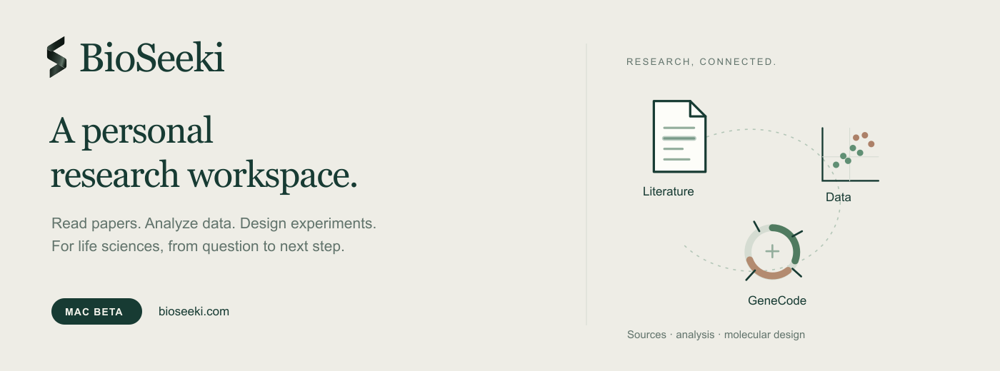
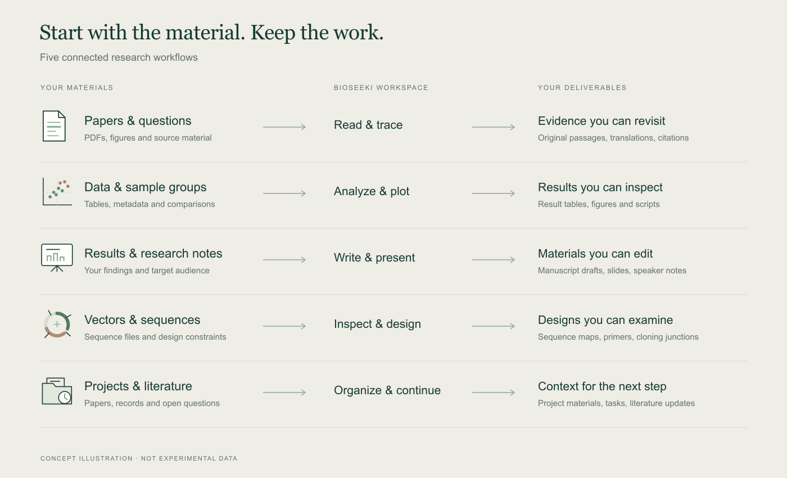

  

  <strong>English</strong> · <a href="README.zh-CN.md">简体中文</a>

  <a href="https://bioseeki.com/download"><strong>Download Mac Beta</strong></a> ·
  <a href="https://bioseeki.com/en">Website</a> ·
  <a href="docs/getting-started.md">Getting started</a> ·
  <a href="https://github.com/zjuphD/BioSeeki/issues">Feedback</a>

BioSeeki is a personal AI research workspace for life sciences. Read papers, analyze data, work with sequences, and develop research materials while keeping the questions, sources, and outputs together.

Explore BioSeeki’s capabilities, get started with practical guides, follow releases, and share feedback here.

## From a research question to usable work

| Work with | What you can do | What you keep |
| --- | --- | --- |
| **Papers & literature** | Search literature, read PDFs in two languages, and return to original passages. | Literature lists, translations, and source locations. |
| **Data & figures** | Analyze data with sample groups and stated analysis conditions. | Result tables, figures, and scripts for review and replotting. |
| **Papers & presentations** | Develop manuscript passages, reports, and lab-meeting presentations from supplied material. | Drafts, editable slides, speaker notes, and sources. |
| **Sequences & molecular design** | Use the integrated **GeneCode** workspace to inspect plasmids, translation, restriction sites, and cloning junctions. | Editable sequences, candidate primers, and cloning designs. |
| **Project materials** | Organize papers, records, tasks, and literature updates around a project. | Searchable materials and context for the next research step. |

The diagrams illustrate workflows; they are not experimental results or performance benchmarks.

## Try BioSeeki

**[Download from the official website →](https://bioseeki.com/download)**

| Current public download | Availability |
| --- | --- |
| macOS | **Beta 0.1.3**, Apple silicon, macOS 14 or later |
| Windows / Intel Mac | Public downloads are not available yet. |

1. Download and open the DMG. Double-click **BioSeeki Beta**.
2. Choose **Install to Applications** when prompted. The app opens after installation. You can also drag it into the **Applications** folder.
3. Sign in or create a BioSeeki account, then start with a research question or add a paper, dataset, or sequence.

The current Mac Beta is signed and Apple-notarized. Installation details and the installer’s SHA-256 are on the [download page](https://bioseeki.com/download). See [release notes](https://github.com/zjuphD/BioSeeki/releases) for version-specific changes.

## Start with your own question

> **Literature:** Find the experiments behind this paper’s main claim. Explain the figures and locate the supporting passages.

> **Analysis:** Check this dataset and sample grouping, explain the analysis conditions, and return the figures, results table, and scripts.

> **Molecular design:** Review this vector and insert. Check the cloning junctions and reading frame, and show the design in GeneCode.

> **Writing:** Turn these results into a 10-minute lab-meeting presentation with speaker notes and source references.

More practical examples: **[Getting started](docs/getting-started.md)** · **[常用场景](docs/getting-started.zh-CN.md)**

## Feedback & community

- **Found a problem?** [Report a bug](https://github.com/zjuphD/BioSeeki/issues/new?template=bug_report.yml).
- **Have a research workflow in mind?** [Suggest an improvement](https://github.com/zjuphD/BioSeeki/issues/new?template=feature_request.yml).
- **Want to discuss how you use it?** [Join Discussions](https://github.com/zjuphD/BioSeeki/discussions).
- **Account, billing, or private support:** [support@bioseeki.com](mailto:support@bioseeki.com).

Public issues are visible to everyone. Use anonymized examples and keep credentials and unpublished research data out of attachments. For vulnerabilities, see the [security contact](SECURITY.md).

If BioSeeki is useful to your work, **Star this repository** to help others find it, or share the [website](https://bioseeki.com/) and [Chinese introduction](README.zh-CN.md) with your lab.

---

[Website](https://bioseeki.com/) · [Download](https://bioseeki.com/download) · [Privacy](https://bioseeki.com/privacy) · [Terms](https://bioseeki.com/terms) · [Repository notice](NOTICE.md)
