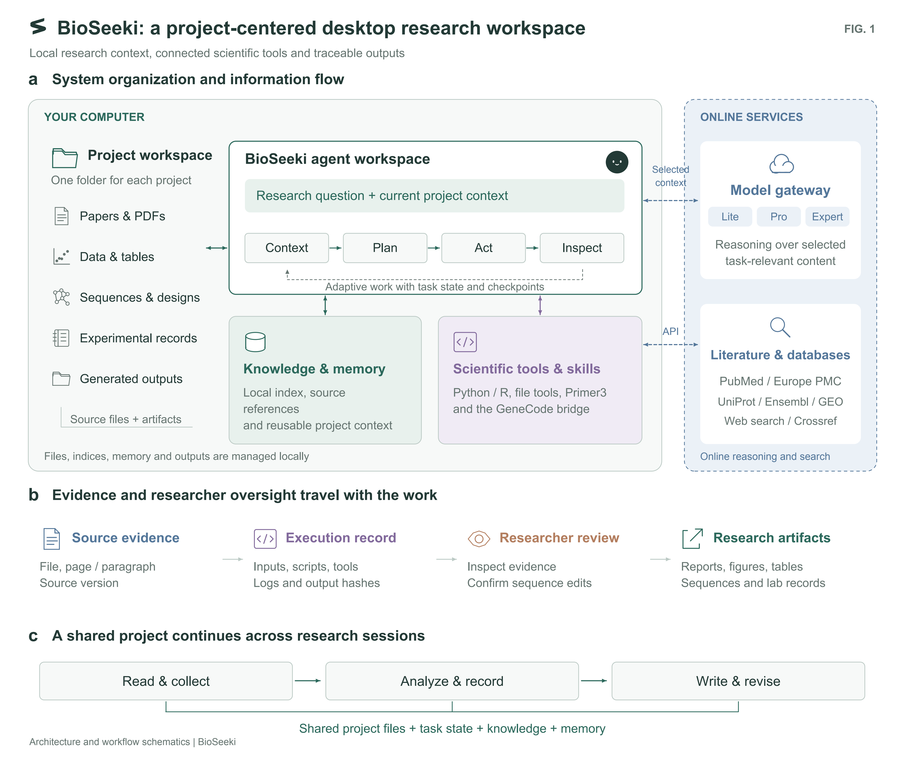
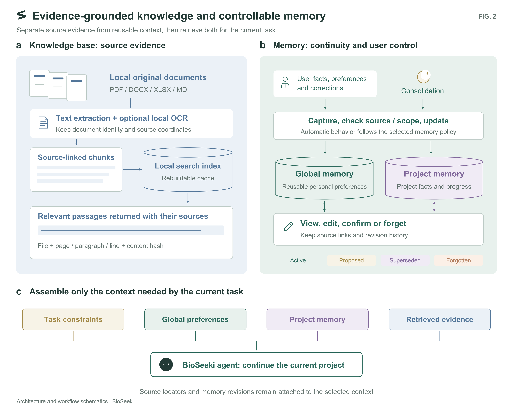
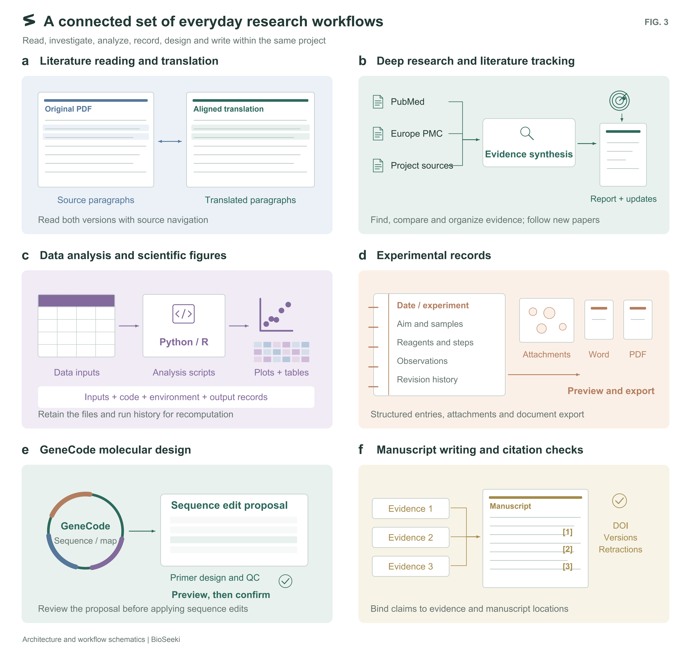

# BioSeeki architecture and research workflows

[Product overview](../README.md) · [中文介绍](../README.zh-CN.md)

Three English figures describe the project workspace, knowledge and memory, and connected research capabilities. Click an image for the full-resolution PNG or use the SVG link below it.

## Figure 1 | BioSeeki as a project-centered desktop research workspace.

**Figure 1 | BioSeeki as a project-centered desktop research workspace.** a, Logical organization and information flow. Project workspaces locally organize papers, data, sequences, experimental records and generated artifacts. Given a research question and the current project context, the agent assembles context, plans, invokes tools and inspects observations. Local knowledge, memory and scientific runtimes support task execution, while the model gateway, literature search and public databases are accessed over the network. Blue dashed connections denote online interactions; the grey dashed connection denotes iterative agent feedback. b, Connections between source evidence, execution records, researcher review and research artifacts. Source versions, document locators, inputs, code, tools and output records support inspection; proposed sequence changes are previewed and confirmed by the researcher before application. c, Shared project files, task state, knowledge and memory connect reading, analysis, record keeping and manuscript revision across sessions.

[Full-resolution PNG](../assets/architecture/Fig1_BioSeeki_architecture_en.png) · [SVG](../assets/architecture/Fig1_BioSeeki_architecture_en.svg)

## Figure 2 | Combining source-grounded knowledge with controllable memory.

**Figure 2 | Combining source-grounded knowledge with controllable memory.** a, The knowledge base preserves inspectable source evidence. Local documents undergo text extraction and optional local OCR to produce source-linked chunks for a rebuildable search index. Retrieved passages retain document identity, applicable page, paragraph or line coordinates, and a content hash. b, Long-term memory preserves reusable personal and project context. User facts, preferences, corrections and consolidation outputs are checked for source and scope before updates are applied under the selected memory policy. Global and project memory are managed separately; users can inspect, edit, confirm or forget records. Representative lifecycle states are shown. c, Task constraints, global preferences, project memory and retrieved evidence are selected for the current task. Source locators and memory revisions remain associated with the selected context to support inspection and continued work.

[Full-resolution PNG](../assets/architecture/Fig2_Knowledge_and_memory_en.png) · [SVG](../assets/architecture/Fig2_Knowledge_and_memory_en.svg)

## Figure 3 | Everyday research capabilities and delivery workflows in BioSeeki.

**Figure 3 | Everyday research capabilities and delivery workflows in BioSeeki.** a, Side-by-side literature reading links original and translated paragraphs with source navigation. b, Deep research combines public literature sources with project materials for retrieval, evidence comparison and synthesis; literature tracking surfaces new relevant publications. c, Data analysis associates inputs, scripts, figures, environments and output records to support recomputation. d, Experimental records organize dates, aims, samples, reagents, procedures, observations, attachments and revisions, with preview and Word/PDF export. e, GeneCode connects sequence and plasmid-map inspection, primer design and quality control, edit proposals and researcher confirmation. f, Manuscript workflows associate claims with evidence and manuscript locations, with checks of DOI identity, publication versions and retraction status. Document, heatmap, scatter-plot and plasmid glyphs are schematic and do not depict experimental measurements or a real construct.

[Full-resolution PNG](../assets/architecture/Fig3_Research_capabilities_en.png) · [SVG](../assets/architecture/Fig3_Research_capabilities_en.svg)

The diagrams describe software architecture and workflows. Their document, heatmap, scatter-plot and plasmid glyphs are schematic, not experimental results or measured benchmarks.
